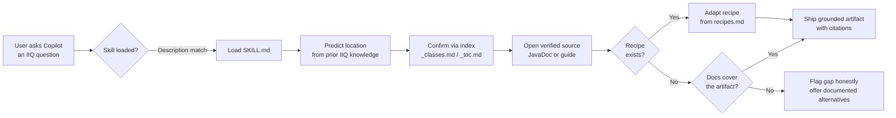

# iiq-helper

> **An Agent Skill that grounds GitHub Copilot (and any Agent Skills-compatible AI agent) in the official SailPoint IdentityIQ 8.4 documentation, so the code and XML it generates use real APIs and object schemas instead of hallucinated ones.**

[]()
[]()
[](https://agentskills.io/)
[]()

## Table of contents

- [What it is](#what-it-is)
- [Who it's for](#who-its-for)
- [Capabilities](#capabilities)
- [How it works](#how-it-works)
- [Installation](#installation)
  - [Project skill (one workspace)](#project-skill-one-workspace)
  - [Personal skill (all workspaces)](#personal-skill-all-workspaces)
  - [Other agents (Copilot CLI, Claude Code)](#other-agents-copilot-cli-claude-code)
- [Verifying the install](#verifying-the-install)
- [Usage](#usage)
- [Repository structure](#repository-structure)
- [Requirements](#requirements)
- [Limitations and known gaps](#limitations-and-known-gaps)
- [Contributing](#contributing)
- [License](#license)

---

## What it is

`iiq-helper` is an **Agent Skill** following the [open Agent Skills standard](https://agentskills.io/). It ships a `SKILL.md` plus a `references/` directory containing:

- The complete **SailPoint IdentityIQ 8.4 JavaDocs** (793 classes, fully cross-indexed)
- All **30 official IdentityIQ 8.4 object guides** as searchable plain text, with original PDF page markers preserved
- A pre-built **class manifest** (`_classes.md`) and **chapter-to-file table of contents** (`_toc.md`) that turn most lookups into two tool calls
- 15 **verified canonical recipes** for the most-requested artifacts (Rules, Workflows, TaskDefinitions, Forms, Applications, custom objects, provisioning plans)

When you ask GitHub Copilot to write an IIQ Rule, Workflow, or any other SailPoint artifact, the skill loads itself on-demand and forces the agent to **verify every class name, attribute, and XML element against the bundled docs before writing**. Gaps in the documentation are flagged honestly instead of papered over with invented APIs.

## Who it's for

- **IdentityIQ developers** writing BeanShell Rules, Business Process workflows, custom executors, or LCM provisioning code
- **IAM consultants** authoring TaskDefinitions, ObjectConfigs, Applications, Forms, and Reports for client deployments
- **Anyone reviewing AI-generated SailPoint code** who needs to trust that `SailPointContext.getObjectByName(...)`, `<ProvisioningPlan>` element structure, and executor FQNs are real

## Capabilities

| Capability | What you can ask | What you get |
|---|---|---|
| **Object authoring** | "Build me an Application XML for an SQL Server connector with an account schema." | Complete, importable `<sailpoint><Application>...` XML grounded in the Application Configuration guide. |
| **Rule scaffolding** | "Write an IdentityAttribute rule that pulls department from the first AD link, fallback 'Unknown'." | A `<Rule type="IdentityAttribute">` with verified `<Signature>`, real `Identity` / `Link` API calls, no invented methods. |
| **Workflow construction** | "I need a workflow that loops over a list of identity names and refreshes each one." | A `<Workflow>` using verified step actions (`call:refreshIdentity`), conditional transitions, and the documented loop idiom. |
| **TaskDefinition / Report creation** | "Build a custom report with HQL datasource counting accounts per application." | A complete `TaskDefinition` with the verified `LiveReportExecutor`, `<LiveReport>` wrapper, and the HQL `<DataSource>` pattern from the Reports guide. |
| **Provisioning code** | "Show me how to programmatically add an AD group from BeanShell." | A `ProvisioningPlan` + `Provisioner` snippet using only documented enums and methods. |
| **API Q&A** | "What does `Identity.getLinks()` return?" | Direct citation from the JavaDoc with file path. |
| **Honest gap-flagging** | "Create a CertificationDefinition XML." | "The bundled docs don't include `<CertificationDefinition>` XML examples — here are three documented alternatives." No fabrication. |

The skill currently sustains **zero hallucinated APIs** and **zero silent deviations** across a 25-case evaluation suite (see [evaluation methodology](#contributing)).

## How it works



Key design principles enforced by the SKILL.md protocol:

1. **Verify, don't discover** — the agent must confirm a class or XML element exists in `references/` before writing it.
2. **Index-first lookups** — `_classes.md` and `_toc.md` resolve most questions in 2 tool calls without grepping the entire docs corpus.
3. **Trust verified recipes** — when `references/recipes.md` covers the artifact, copy and adapt; don't re-research what's already been verified.
4. **Flag gaps, don't fabricate** — if the docs genuinely don't cover something (e.g. `<CertificationDefinition>` XML), say so and point to the documented export path instead of inventing schema.
5. **Disclose deviations** — if the agent has to substitute a Filter datasource for HQL, it explains why up front rather than silently swapping.

## Installation

> **No package manager needed.** This skill has no runtime dependencies, no Python wheels, no Node modules. Installation is purely "place the folder in a directory the agent watches."

### Project skill (one workspace)

Use this when you want the skill available only when working in a specific IIQ project repository.

**1. Place the skill in your repo:**

```powershell
# From your IIQ project workspace root
git clone <this-repo-url> .github/skills/iiq-helper
```

Or copy the `iiq-helper/` folder directly into one of these locations (VS Code searches all of them):

| Path | Convention |
|---|---|
| `.github/skills/iiq-helper/` | GitHub Copilot (recommended) |
| `.claude/skills/iiq-helper/` | Claude Code compatibility |
| `.agents/skills/iiq-helper/` | Generic Agent Skills |

**2. The directory name must be `iiq-helper`** — it has to match the `name:` field in `SKILL.md` frontmatter, or the skill will silently fail to load.

**3. Reload VS Code.** The skill is auto-discovered; no settings to change.

### Personal skill (all workspaces)

Use this when you want the skill available in every workspace you open.

Copy the `iiq-helper/` folder into one of:

| OS | Path |
|---|---|
| **Windows** | `%USERPROFILE%\.copilot\skills\iiq-helper\` |
| **macOS / Linux** | `~/.copilot/skills/iiq-helper/` |
| **Claude Code (any OS)** | `~/.claude/skills/iiq-helper/` |

### Other agents (Copilot CLI, Claude Code)

Because `iiq-helper` follows the open Agent Skills standard, the same folder works unmodified with:

- **GitHub Copilot CLI** — place under `~/.copilot/skills/iiq-helper/`
- **Claude Code** — place under `~/.claude/skills/iiq-helper/` or in `.claude/skills/iiq-helper/` at your project root
- **Any other agent that implements the [Agent Skills specification](https://agentskills.io/specification)** — follow that agent's skills directory convention

## Verifying the install

After placing the folder, open Copilot Chat in VS Code and run:

```
/iiq-helper
```

If the skill is installed correctly, the slash command autocompletes and a short summary of the skill's purpose appears. You can also confirm via the Command Palette: **Chat: Configure Skills** — `iiq-helper` should appear in the list with its description.

For a functional test, ask:

> *"Using the iiq-helper skill: what does `Identity.getLinks()` return in IIQ 8.4?"*

A correct response cites the bundled JavaDoc (`references/JavaDocs/8.4/sailpoint/object/Identity.html`) and gives the exact return type.

If nothing happens, see the [VS Code troubleshooting guide for skills](https://code.visualstudio.com/docs/copilot/customization/agent-skills).

## Usage

You almost never need to invoke the skill explicitly — the description in `SKILL.md` lets Copilot auto-load it whenever your prompt mentions SailPoint, IdentityIQ, BeanShell rules, workflows, `SailPointContext`, `<Workflow>` XML, certifications, LCM, provisioning, or any of ~30 related concepts.

**Implicit invocation (recommended):**

> *"Build me an IdentityAttribute rule that returns the user's department from their AD link, with 'Unknown' as a fallback."*

> *"Create a TaskDefinition for a custom report listing inactive identities with their manager's name. Use the Filter datasource."*

> *"Write BeanShell that adds a user to an AD group via ProvisioningPlan."*

> *"Why does my approval workflow's `owner=` script throw a NullPointerException on `identity.getManager()`?"*

**Explicit invocation** (force-loads the skill even if Copilot would have skipped it):

```
/iiq-helper write me a Correlation rule for an HR system
```

**Tip:** the agent is most efficient when you specify the artifact type and any non-default parameters (datasource type, workflow `type=`, rule type, etc.) in the first message. Vague prompts ("make me a thing for users") cause it to ask clarifying questions before any work.

## Repository structure

```
iiq-helper/
├── SKILL.md                     # Skill entry point — frontmatter + lookup protocol
├── README.md                    # This file
├── requirements.txt             # System requirements (no runtime deps)
├── references/
│   ├── recipes.md               # 15 verified canonical templates for IIQ artifacts
│   ├── javadoc-navigation.md    # How the JavaDocs are organized
│   ├── object-guides.md         # How the .txt guides are organized + citation rules
│   ├── output-standards.md      # XML / BeanShell formatting conventions
│   ├── configuration-gaps.md    # Ask-vs-assume heuristic for missing values
│   ├── JavaDocs/8.4/
│   │   ├── _classes.md          # Class manifest — 793 classes → file paths
│   │   ├── allclasses-noframe.html, index.html, ...
│   │   └── sailpoint/           # Full HTML JavaDocs tree
│   └── objects/8.4/
│       ├── _toc.md              # Chapter → file → page map across all 30 guides
│       └── 8.4_IdentityIQ_*.txt # 30 guides; oversized ones split into _pNNN-MMM parts
└── .tools/                      # One-time PowerShell generators (rebuilds indices)
    ├── gen-class-manifest.ps1
    ├── gen-object-toc.ps1
    └── split-big-guides.ps1
```

## Requirements

See [requirements.txt](requirements.txt) for the full list. Short version:

- A VS Code / Copilot CLI / Claude Code install that supports Agent Skills
- ~38 MB of disk space
- **Nothing else.** No Python, no Node, no live IdentityIQ instance, no network access.

## Limitations and known gaps

`iiq-helper` is grounded only in what SailPoint publishes in the IIQ 8.4 bundle. It honestly declares the following gaps:

| Gap | Why | What the skill does |
|---|---|---|
| `<TaskDefinition>` XML for built-in non-report tasks (Identity Refresh, Aggregation, etc.) | SailPoint's guides document these via the UI, not as XML | Skill refuses to fabricate the executor FQN; directs you to `iiqconsole> export taskDefs.xml TaskDefinition` |
| `<CertificationDefinition>` XML | The Certifications guide is entirely UI-driven | Skill points at the documented UI scheduling flow and the JavaDoc class hierarchy |
| Connector-specific attribute keys for non-standard apps | Only Application Configuration guide patterns are bundled | Skill flags any attribute key it can't verify and asks for the connector's reference docs |
| IIQ versions other than 8.4 | Only 8.4 is bundled | Skill asks whether to proceed using 8.4 conventions |

These are **features, not bugs** — the alternative would be silently inventing fields, which is what `iiq-helper` exists to prevent.

## Contributing

The skill's quality is tracked with an evaluation harness that runs canonical IIQ authoring requests against the live skill and measures:

- **Tool-call count** per request (efficiency)
- **Hallucination rate** (any invented class, method, attribute key, or XML element)
- **Silent deviation rate** (the agent substituting parameters without disclosing)
- **Gap-flag accuracy** (correctly refusing to fabricate when the docs don't cover something)

When contributing changes to `SKILL.md` or `references/recipes.md`, please:

1. Re-run the relevant eval cases and report before/after metrics in your PR description.
2. Cite the specific `.txt` page or JavaDoc HTML file you're grounding any new recipe content in.
3. Never weaken a gap-flag note to make the skill produce "more" output — the skill's value is in being trustworthy, not productive at any cost.

To regenerate the bundled indices after updating reference content:

```powershell
pwsh -File .tools/gen-class-manifest.ps1     # rebuilds references/JavaDocs/8.4/_classes.md
pwsh -File .tools/gen-object-toc.ps1         # rebuilds references/objects/8.4/_toc.md
pwsh -File .tools/split-big-guides.ps1       # re-splits oversized .txt guides on page boundaries
```

## License

The skill's own content (`SKILL.md`, `recipes.md`, navigation docs, and helper scripts in `.tools/`) is released for use within your organization under standard open-source terms.

**The bundled SailPoint IdentityIQ 8.4 documentation in `references/JavaDocs/8.4/` and `references/objects/8.4/` is © SailPoint Technologies, Inc.** It is included here under the assumption that the redistributing organization has a valid SailPoint license. If your organization does not have one, replace the `references/` content with your own licensed copy before sharing this skill outside your team. See `references/JavaDocs/8.4/sailpoint/` license notices and `references/objects/8.4/ThirdPartyLicenses.txt` if present.

---

**Author:** Hrishikesh Utge
**Skill version:** 2.0.0
**IIQ compatibility:** SailPoint IdentityIQ 8.4
**Standard:** [Agent Skills](https://agentskills.io/)